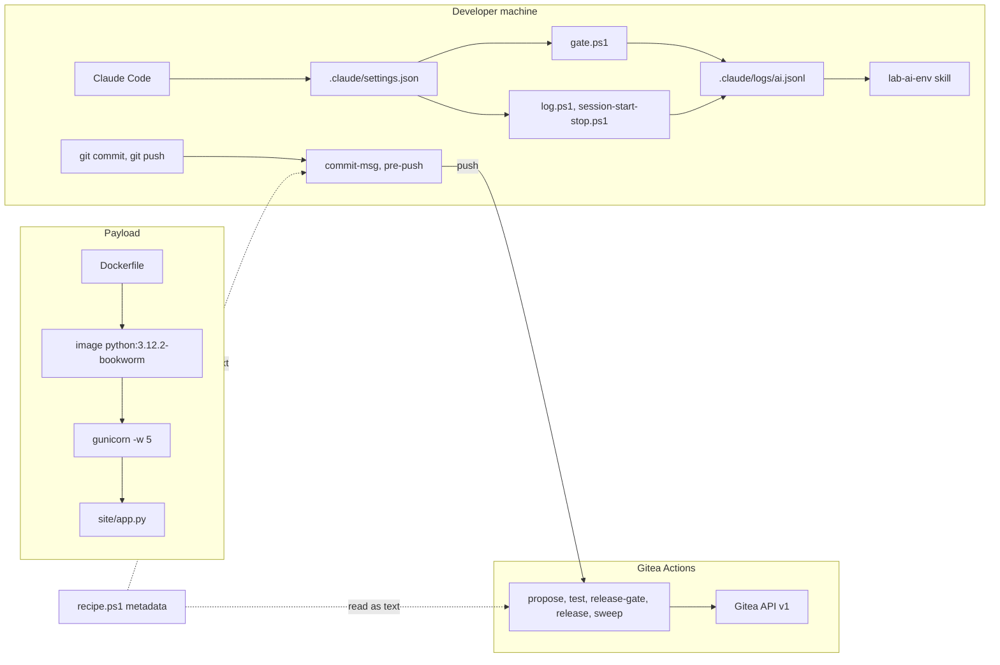

# dev-ops-test1 - documentation hub

dev-ops-test1 is a DevOps exercise from February 2024: a three-route Flask site
(`site/app.py`) packaged by a `Dockerfile` into an image that gunicorn serves
(`README.md:3-5`). On 2026-11-07 the repository received the owner's "lab"
tooling: a PowerShell entry script (`recipe.ps1`), Claude Code hooks, git hooks
and five Gitea Actions workflows that judge branch names, commit wording and
releases. Who the intended audience is, beyond the owner, is not stated in the
repository (see [Open questions](../SPEC.md#9-open-questions)).

Sources are given as `path:line`. Short names: `gate.ps1`, `log.ps1`,
`session-start-stop.ps1` are in `.claude/hooks/`; `commit-msg*` and
`pre-push*` in `.claude/hooks/git/`; `*.yaml` in `.gitea/workflows/`.

## Status

- Last commit: `f87b08f`, 2026-11-07 23:59 +0200, the merge of `test` into
  `release` (`git log -1`). The tag `v1.0.0` points at this commit (`git tag -l`,
  `git rev-list -n1 v1.0.0`).
- The site and the Dockerfile have one commit each, `91568fd` of 2024-02-25
  (`git log -- site/app.py Dockerfile`). Every later commit adds tooling or
  documentation (`README.md`, `LICENSE`, `CLAUDE.md`) only.
- Tests: none. `python -m pytest --collect-only -q -p no:cacheprovider .claude`
  reports "no tests collected" (exit 5), which `recipe.ps1:47-48` accepts.
  Nothing tests `site/app.py` or the hook scripts.
- CI: five workflows in `.gitea/workflows/` (Gitea Actions, runner label
  `windows`). Whether a runner serves this repository is not recorded here;
  `CLAUDE.md` describes both cases ("Where no runner serves this repository
  there is no gate").
- TODO/FIXME markers in tracked files: 0.
- Evidently unfinished: the `/blog` route answers `HERE WILL BE ARTICLES` and
  has no articles (`site/app.py:13-15`); `flask` and `gunicorn` are not pinned
  (`Dockerfile:5`); `README.md:24` states that neither the image nor the site
  is built or tested in the repository.

## Layout

| Path | What it is |
|---|---|
| `site/app.py` | Flask application, three routes returning fixed strings |
| `Dockerfile` | Image on `python:3.12.2-bookworm`, gunicorn entry point |
| `recipe.ps1` | The repository's command interface (verbs `build install uninstall clean run publish info test`) and its metadata (`$Name`, `$Code`, `$Version`, commit/branch vocabulary, `$Reviewers`, `$OverridePhrase`) |
| `CLAUDE.md` | Working rules: branch and commit grammar, keys, gates, release procedure |
| `README.md` | Project README |
| `LICENSE` | MIT licence |
| `.claude/settings.json` | Claude Code hook registration and three environment variables |
| `.claude/hooks/gate.ps1` | PreToolUse gate for Bash/PowerShell calls: denies recursive deletes, force-pushes, history rewrites on `test`/`release` |
| `.claude/hooks/log.ps1` | Appends hook events to `.claude/logs/ai.jsonl` |
| `.claude/hooks/session-start-stop.ps1` | SessionStart/Stop/SessionEnd: log rotation, `core.hooksPath`, branch/issue context |
| `.claude/hooks/git/commit-msg`, `commit-msg.ps1` | git hook: commit subject grammar, `Signed-off-by`, no BOM |
| `.claude/hooks/git/pre-push`, `pre-push.ps1` | git hook: Git LFS hand-off, branch grammar, guarded pushes to `release` |
| `.claude/skills/lab-ai-env/SKILL.md` | Claude Code skill: report on `.claude/logs/ai.jsonl` and session transcripts |
| `.claude/ruff.toml` | Pins ruff to `==0.16.1` |
| `.claude/pytest.ini` | Empty `[pytest]` section |
| `.gitea/workflows/*.yaml` | `propose`, `test`, `release-gate`, `release`, `sweep` |
| `.gitea/issue_template.md`, `pull_request_template.md` | Issue and pull request templates |
| `.gitattributes`, `.gitignore` | Line endings, LFS patterns; ignored caches, `.claude/logs/`, `.claude/.env` |

## Architecture

Two parts share the repository and do not call each other.

1. Payload. `docker build` copies `site/` to `/site`, installs `flask` and
   `gunicorn`, and the entry point runs `gunicorn -w 5 -b 0.0.0.0 app:app`
   (`Dockerfile:1-11`). gunicorn imports the `app` object from `site/app.py`.
   No database, templates or external service is involved.
2. Lab tooling. `recipe.ps1` holds the metadata as one-line literals; the git
   hooks and the workflows read those lines as text with regular expressions
   (e.g. `propose.yaml:48-70`, `pre-push.ps1:16-45`) instead of executing the
   script. Claude Code runs the hooks registered in `.claude/settings.json`;
   they write `.claude/logs/ai.jsonl`, which the `lab-ai-env` skill reads.
   The workflows call the Gitea REST API (`/api/v1`) with the secret
   `LAB_BOT_TOKEN`.



Branch flow as the workflows implement it: work branch
`dot-<issue>/<type>/<slug>` -> pull request into `test` (`propose.yaml`) ->
push to `test` (`test.yaml`) -> pull request from `test` into `release`
(`release-gate.yaml`) -> push to `release` publishes `v<$Version>` and merges
`release` back into `test` (`release.yaml`). `sweep.yaml` deletes merged work
branches and ages out idle pull requests.

## Build and run

Prerequisites, as far as the files name them:

- Docker, for the site (`README.md:17`). The image brings Python 3.12.2
  (`Dockerfile:1`).
- Windows PowerShell (`powershell.exe`) for `recipe.ps1`, the Claude Code hooks
  (`.claude/settings.json:8-18`) and the git hooks (`commit-msg:3`,
  `pre-push:7`); Git for Windows' `sh` runs the git hook wrappers
  (`commit-msg:2`).
- For `recipe.ps1 test`: Python with `pytest` (no version pinned) and
  `ruff==0.16.1` (`.claude/ruff.toml:2`), both run as `python -m ...`
  (`recipe.ps1:46-52`).
- Optional: `git-lfs`, used by `pre-push` when present (`pre-push:4-6`).

Build and run the site (`README.md:19-22`):

```bash
docker build -t dev-ops-test1 .
docker run -p 8000:8000 dev-ops-test1
```

There is no install step and no `requirements.txt`; the packages are installed
inside the image (`Dockerfile:5`). `recipe.ps1 build`, `install`, `run` and
`publish` print `nothing to <verb>` (`recipe.ps1:69-73`).

## Configuration

| Name | Where | Meaning | Default |
|---|---|---|---|
| `.claude/.env` | read by `recipe.ps1:30-38` | `KEY=VALUE` lines exported as environment variables unless already set; gitignored (`.gitignore:24`) | absent |
| `PYTHONIOENCODING`, `PYTHONUTF8`, `MSYS_NO_PATHCONV` | `.claude/settings.json:3-5` | Environment for Claude Code sessions: UTF-8 Python I/O, no MSYS path conversion | `utf-8`, `1`, `1` |
| `core.hooksPath` | set by `recipe.ps1:42` and `session-start-stop.ps1:34` | Points git at `.claude/hooks/git` | set on first `test` or session start |
| `$Name`, `$Code`, `$Version`, `$Summary` | `recipe.ps1:9-12` | Metadata printed by `info`; `$Version` names the release tag | `dev-ops-test1`, `dot`, `1.0.0` |
| `$CommitTypes`, `$CommitScopes`, `$BranchTypes` | `recipe.ps1:19-21` | Vocabulary for commit subjects and branch names | see the file |
| `$Reviewers` | `recipe.ps1:22` | Logins allowed to merge into `release` and write the override | one login |
| `$OverridePhrase` | `recipe.ps1:23` | Marker line of the owner's override (value not repeated here) | see the file |
| `$App`, `$Provides`, `$Needs`, `$Tools` | `recipe.ps1:13-17` | Decide whether the workflows build an installer, a wiki, a changelog; feed the SBOM | not set / empty |
| `LAB_BOT_TOKEN` | Gitea secret, every workflow | API token for statuses, comments, releases, packages | not in the repository |
| `WAIT_MINUTES` | `release-gate.yaml:101` | How long `manual-gate` waits for a manual verdict | `150` |
| `required-version` | `.claude/ruff.toml:2` | ruff refuses any other version | `==0.16.1` |
| gunicorn flags | `Dockerfile:11` | `-w 5` workers, `-b 0.0.0.0` bind address | fixed in the image |

The Flask application reads no configuration (`site/app.py:1-15`).

## Usage

1. Serve the site with the two Docker commands above, then request `/`,
   `/about` and `/blog` on port 8000. Expected bodies: `MAIN PAGE`,
   `THIS IS THE ABOUT PAGE`, `HERE WILL BE ARTICLES` (`site/app.py:5-15`).
2. Print the metadata (`README.md:29`):

   ```powershell
   .\recipe.ps1 info
   ```

   Output on 2026-11-18: four lines `Name`, `Code`, `Version`, `Summary`,
   exit code 0.
3. Check a change before proposing it (`CLAUDE.md`, rule 3):

   ```powershell
   & (Join-Path (git rev-parse --show-toplevel) recipe.ps1) test
   ```

   Read `$LASTEXITCODE` right after the call. The verb sets `core.hooksPath`,
   runs pytest, `ruff check` and `ruff format` (in place) over `.claude`.
4. Remove `__pycache__`, `.pytest_cache` and `.ruff_cache` directories:
   `.\recipe.ps1 clean` (`recipe.ps1:63-68`; the verb list is in
   `recipe.ps1:3`).
5. Contribute: open an issue, branch `dot-<issue>/<type>/<slug>`, commit with
   `git commit -s` and a subject `<type>(<scope>): <what changed>`, open a pull
   request into `test` (`CLAUDE.md`, rules 1-3). The `commit-msg` and
   `pre-push` hooks refuse other forms locally; `propose.yaml` judges them
   again on the server.
6. Ask Claude Code for an AI usage report ("lab-ai-env"); the skill writes
   `.claude/logs/report-<date>.md` (`.claude/skills/lab-ai-env/SKILL.md:48-49`).

## Testing

- `recipe.ps1 test` is the only test entry point (`recipe.ps1:41-55`). It
  collects pytest tests under `.claude` only; there are none, and exit code 5
  ("no tests collected") counts as a pass (`recipe.ps1:47-48`,
  `.claude/pytest.ini:2`).
- `ruff check` and `ruff format` cover `.claude` only, where no Python file
  exists; `site/app.py` is outside their path (`recipe.ps1:45`).
- The workflows `propose`, `test` and `release-gate` run `recipe.ps1 test`
  and then `git diff --exit-code`, so unformatted code fails the gate
  (`propose.yaml:144-152`, `test.yaml:54-58`, `release-gate.yaml:49-53`).
- Manual tests: `release-gate.yaml:107-149` reads `tests/manual/tests.json`.
  The file does not exist, so the gate posts `manual/verdict` = success,
  "no manual tests defined".
- Nothing covers the Flask routes, the Docker image or the hook scripts.

## Known limitations and problems

- `flask` and `gunicorn` are installed unpinned (`Dockerfile:5`), and there is
  no lock file; an image built today can differ from one built in 2024.
- `site/app.py` has no `if __name__ == '__main__'` block; the only run path in
  the repository is gunicorn inside the image (`Dockerfile:11`).
- `Dockerfile:11` binds `0.0.0.0` without a port. Inference: gunicorn then
  uses its default port 8000, which matches `EXPOSE 8000` (`Dockerfile:9`);
  the repository does not state it.
- The Dockerfile sets no `USER`, so the container runs as the base image's
  default user (inference: root for `python:*-bookworm`).
- `README.md:30` says every verb other than `test` and `info` prints
  `nothing to <verb>`; `clean` deletes cache directories instead
  (`recipe.ps1:63-68`).
- Commit `8393f05` is titled "pin ruff and pytest", but only ruff is pinned
  (`.claude/ruff.toml:2`); `.claude/pytest.ini` holds no version.
- `test.yaml:38` requires `mypy` on the runner, and no step uses it.
- Workflow steps reference files that are absent: `tools/wiki.py`
  (`test.yaml:85`), `tests/manual/serve.py` (`release-gate.yaml:210`),
  `dist/*.exe` (`release-gate.yaml:63`). They are skipped here because
  `recipe.ps1` declares no `$App` or `$Provides`, or the manual test list is
  absent.
- `gate.ps1:135` deletes all quote characters before splitting the command on
  `;`, `|`, `&` (`gate.ps1:42`), so a separator inside a quoted argument
  starts a new segment that is judged as a command. Checked on 2026-11-18 by
  running a copy of `gate.ps1` outside the repository:
  `git commit -m "note; rm -rf build"` is denied as a recursive delete.
- The `.gitea/workflows` files run on Gitea Actions; the GitHub copy of the
  repository does not execute them (inference: GitHub Actions reads only
  `.github/workflows`).
- The lab-requirements link in `README.md:39` points to `127.0.0.1:3000`, so it
  does not resolve outside the owner's machine.
- The git hook wrappers are stored with mode `100644` (`git ls-files -s`).
  Inference: Git for Windows runs them; on Linux or macOS git skips a hook
  that is not executable.

## Related documents

- [Project README](../README.md)
- [Software requirements specification](../SPEC.md)
- [Working rules (CLAUDE.md)](../CLAUDE.md)
- [lab-ai-env skill](../.claude/skills/lab-ai-env/SKILL.md)
- [Issue template](../.gitea/issue_template.md),
  [pull request template](../.gitea/pull_request_template.md)
- [Licence](../LICENSE)

## About this document

Written 2026-11-18 from commit `f87b08f` (branch `release`), by reading every
tracked file.

Commands run to check it:

- `git status`, `git log`, `git ls-files`, `git ls-files -s`, `git show --stat`,
  `git tag -l`, `git rev-list`, `git merge-base --is-ancestor`, `git remote -v`.
- `python -m pytest --collect-only -q -p no:cacheprovider .claude` -> "no tests
  collected", exit 5.
- `powershell -File recipe.ps1 info` -> four metadata lines, exit 0.
- `powershell -File recipe.ps1 build` -> `nothing to build`, exit 0.
- Version probes on the documenting machine: pytest is installed; `ruff`,
  `flask` and `gunicorn` are not, so `recipe.ps1 test` would stop at its ruff
  step there.

Not run: `recipe.ps1 test` (it writes `core.hooksPath` and reformats files in
place), `recipe.ps1 clean`, `docker build` / `docker run` (network and a
build), the git hooks, the Claude Code hooks (except the copy of `gate.ps1`
named under "Known limitations") and any workflow.
